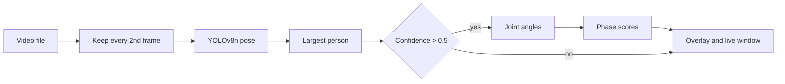

# Pole Vault AI

A Python tool that runs pose estimation on pole vault video, draws the vaulter's limbs on each frame, and scores three phases of the jump from joint angles.

I built this as my high school senior project (April 2024 to May 2025). I was a pole vaulter, and I wanted a way to look at my own technique with numbers attached.

## Why

Feedback on a vault usually comes from someone squinting at slow-motion video. A coach scrubs back and forth, pauses near the takeoff, and gives a verdict by eye. I wanted to see whether a computer could track the body through the jump and put a number on what it saw. The goal was a first version that works on ordinary phone or broadcast clips and that other people can build on.

## How it works

1. **Read the video.** OpenCV opens the clip and keeps every second frame. The script assumes a 24 fps source and targets about 10 fps, which gives a skip factor of 2.
2. **Find people.** Each kept frame goes through YOLOv8 pose (`yolov8n-pose.pt`, the nano model from Ultralytics). It returns a bounding box and 17 body keypoints for every person it detects.
3. **Pick the vaulter.** Track meets have coaches, officials and other athletes in frame. The script keeps the largest bounding box, on the idea that the vaulter is usually closest to the camera. It also compares box centers between frames to note when the main subject moves.
4. **Check confidence.** Keypoints are only used when the detection confidence is above 0.5. This cut down on jumpy or wrong keypoints.
5. **Measure angles.** For a joint, the script builds two vectors (upper segment and lower segment), takes their dot product, and converts it to an angle in degrees.
6. **Score the phases.** Each angle is compared to hand-picked thresholds, which give a score of 100%, 70% or 50% for takeoff, invert and push-off.
7. **Draw the result.** OpenCV draws the arms, legs and hips/shoulders as lines on the frame and prints the phase scores in the corner. `pose-estimation.py` also prints an average score and a short feedback line.



## What it measures

Keypoint numbers follow the COCO layout that YOLOv8 pose uses (5 left shoulder, 7 left elbow, 9 left wrist, 11 left hip, 13 left knee, 15 left ankle).

| Phase | Joint used | How it is scored |
| --- | --- | --- |
| Takeoff | Left leg bend (hip, knee, ankle) | Under 45 degrees: 100%. Under 90: 70%. Otherwise 50%. |
| Invert | Left leg bend (hip, knee, ankle) | Under 90 degrees: 100%. Under 120: 70%. Otherwise 50%. |
| Push-off | Left arm bend (shoulder, elbow, wrist) | Under 45 degrees: 100%. Under 90: 70%. Otherwise 50%. |

The angle is the bend between the two segments, so 0 degrees means the limb is straight. A straighter leg or arm scores higher.

The script also tracks which phase the jump is in. It starts at takeoff, moves to invert when the invert score passes 70%, and moves to push-off when the push-off score passes 70%.

With `show_angle=True`, it shows the left knee angle on the video and plots angle against frame number in a live Matplotlib chart.

Scores are computed per frame and update as the video plays.

## Run it

You need Python 3 and a machine with a display, since the script opens a video window.

```bash
git clone https://github.com/Alex-Epstein/Pole-Vault-AI.git
cd Pole-Vault-AI
python3 -m venv venv
source venv/bin/activate        # Windows: venv\Scripts\activate
pip install ultralytics opencv-python numpy matplotlib
python pose-estimation.py
```

`ultralytics` installs PyTorch, which runs the YOLOv8 model. The model weights (`yolov8n-pose.pt`) are already in the repo.

The repo includes sample clips: `video3.mp4`, `video4.mp4`, `mondo1.mkv`, `mondo2.mkv` and `lebron.mkv` (the last one was an early test on basketball footage). The script loads `video3.mp4` by default. To try another clip, change the file name in `run_analyze_pose()`:

```python
pe = PoseEstimation('mondo1.mkv')
```

To see the knee angle and the live angle chart, switch the call at the bottom of the file to:

```python
run_analyze_pose(show_angle=True)
```

Press `q` to close the video window.

`SP.py` is an earlier version of the same script. It shows the three phase scores without the total score and feedback line.

## Repo layout

| File | What it is |
| --- | --- |
| `pose-estimation.py` | Main script. Pose estimation, limb overlay, phase scores, total score and feedback. |
| `SP.py` | Earlier version with phase scores only. |
| `yolov8n-pose.pt` | Pretrained YOLOv8 nano pose weights from Ultralytics. |
| `video3.mp4`, `video4.mp4` | Sample pole vault clips. |
| `mondo1.mkv`, `mondo2.mkv` | Sample pole vault clips, named for world record holder Mondo Duplantis. |
| `lebron.mkv` | Basketball clip used to test pose tracking early on. |
| `Senior Project Website.txt` | HTML for a beginner pole vault help page that links to this code. |
| `Alex Epstein - Senior Project Final Presentation.pdf` | Final presentation for the project. |

## Background research

Before writing code I read papers on pole vault biomechanics and studied the math the analyzer needed. That included the dot product for joint angles, conservation of energy for modeling a jump, and the different phases of a vault. I also built a small tennis swing analyzer to learn YOLOv8 before moving to pole vault footage. The presentation covers this work.

## Limits and next steps

- The scoring thresholds are hand-picked. They have not been checked against coach ratings or measured jumps.
- Only the left leg and left arm are scored.
- The model is used as-is. No custom training was done for pole vault poses.
- The frame rate is hard-coded to 24 fps.
- The video file is set in the code. A command-line argument would make it easier to use.

## Presentation

The full project write-up is in [Alex Epstein - Senior Project Final Presentation.pdf](./Alex%20Epstein%20-%20Senior%20Project%20Final%20Presentation.pdf). It covers the research, the tennis mini-project, the pole vault analyzer, the help website and what I learned along the way.
